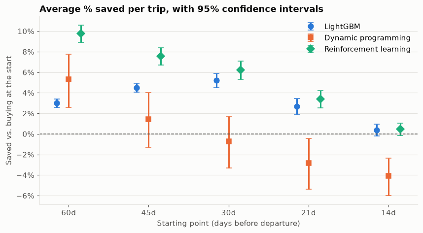
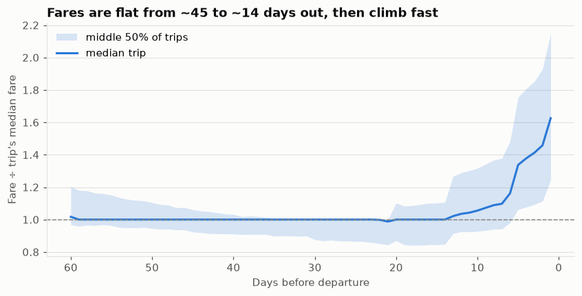
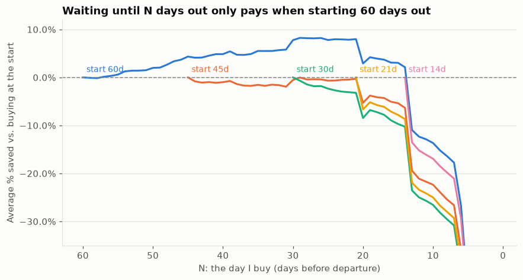

# Buy now or wait? Flight purchase timing as optimal stopping

I travel a lot and I'm always hunting for the best fare, which means always
asking the same question: **should I book now, or will it get cheaper?** This
project answers that with data. It treats buying a ticket as an
**optimal stopping problem**, builds a model that decides trip by trip whether
to wait, and measures the result in dollars and percent with an honest,
walk-forward backtest on 82 million Expedia fares.

## Result

Starting 30–60 days before departure, tested on about 49,000 trip decisions
the model never saw:

| Metric | Result | 95% CI (cluster bootstrap by route) |
|---|---|---|
| Average saved per trip vs. buying immediately | **4.5%** | 4.1–4.9% |
| Share of total spend saved | **6.7%** | 6.2–7.3% |
| Dollars saved per trip | **$9.35** | $8.35–$10.42 |
| Trips where waiting cost money | **4.3%** | 3.6–5.1% |



- Savings are clearly above zero from 21 to 60 days out. From 14 days out
  there's too little left to win to claim any.
- The model saves more on expensive tickets: 3% under $200, 11% for
  $200–500, 19% over $500.
- On the same trips, it beats the simple rule "buy 21 days out" when
  starting 30 or 45 days out, but **loses to it from 60 days out**, where
  fares drift down slowly for weeks.
- A **dynamic-programming policy** (Bellman equation solved in MATLAB on a
  fitted jump model) plans over the whole window and saves about **6% per trip
  from 60 days out**, twice the model's 3%, but loses closer in, where its
  simpler price model breaks down.
- **Reinforcement learning (fitted Q-iteration)** learns the value of waiting
  directly from past price paths, with no price model, and does best of all:
  **about 10% per trip from 60 days out, 7.6% from 45 and 6.2% from 30**,
  losing money on 5–10% of trips. Savings are positive in every test month but
  vary by season (12–14% for June decisions, 2–7% later). Confidence intervals
  for this comparison are being added to notebook 09.

## What the data shows



- Fares are flat from about 45 to 14 days out, then climb in **steps at about
  21, 14 and 7 days**, which looks like airlines' advance-purchase deadlines.
  One day out, the typical fare is 1.6× its usual level.
- Prices **jump rather than drift**: the cheapest fare is unchanged on 60% of
  days, and when it moves, the median move is about 14%.
- **Panel econometrics (R, `fixest`)** confirm the deadline jumps beyond the
  smooth trend: **+5.0% at 21 days, +9.7% at 14, +2.2% at 7** (p < 0.001,
  route-clustered).
- **"Search on a Tuesday" is a myth** (the search day moves fares by under 1%),
  but **the day you fly matters**: Sunday flights cost about 35% more than
  Tuesday flights on the same route and month.
- Routes where **Spirit or Frontier** has a real presence have fares about
  **36% lower**, holding distance and concentration fixed (a correlation;
  airlines choose their routes).
- **Price moves partly reverse**: daily autocorrelation is −0.28, and the
  variance ratio is 0.23 over 20 days.



- **Waiting blindly mostly loses money.** Only from 60 days out does a fixed
  "wait until N days out" rule help. Chosen honestly (walk-forward), the best
  fixed rule is "buy now" everywhere. That's why the model has to decide trip
  by trip.

## Approach

1. **Data.** Kaggle [Flight Prices](https://www.kaggle.com/datasets/dilwong/flightprices):
   82M one-way US domestic fares scraped from Expedia, Apr–Oct 2022, 16 major
   airports, 1–60 days before departure. 31 GB of CSV converted to Parquet
   (4.5 GB) and queried with SQL (DuckDB).
2. **The decision.** For each trip (route × flight date), each day I see the
   cheapest fare and either buy or wait. A strategy may only use information
   available that day (formally, the buying day is a *stopping time*). Savings
   are measured against buying on the first day, in $ and in two kinds of %
   (per-trip average and share of total spend).
3. **Theory.** From the Bellman equation, the optimal policy is a threshold:
   buy once the fare is below a cutoff that rises as departure approaches.
4. **Model.** LightGBM estimates the probability that the fare drops at least
   5% within the next *h* days, using only same-day information: fare vs. the
   route's usual level, days to departure, recent moves, what's on offer, and
   the route. Wait while that probability exceeds a cutoff θ, which is the
   expected-value rule *p > L / (G + L)*.
5. **Honest evaluation.** Walk-forward by month. Each test month learns only
   from trips that had **already departed**. The label window *h* and the
   cutoff θ are chosen on a validation set, never on the test month. Labels
   cut off by the end of data collection (right-censoring) are excluded.
6. **Uncertainty.** A cluster bootstrap by route gives the confidence
   intervals (trips on the same route aren't independent; ignoring that makes
   intervals 2–3× too narrow), plus paired comparisons against simple rules
   on the same trips.

Every derivation (stopping times, the threshold proof, logistic regression
and boosting, the expected-value cutoff, the cluster bootstrap) is written out
step by step in [`notebooks/math_reference.ipynb`](notebooks/math_reference.ipynb).

## Notebooks

| Notebook | What it covers |
|---|---|
| [01 · Data overview](notebooks/01_data_overview.ipynb) | What's in the 82M rows, coverage, data quality |
| [02 · Price dynamics](notebooks/02_price_dynamics.ipynb) | How the cheapest fare moves toward departure |
| [03 · Fare econometrics (R)](notebooks/03_fare_econometrics.ipynb) | Fixed effects, deadline discontinuities, day-of-week myth, Spirit effect, reversal |
| [04 · Decision problem](notebooks/04_decision_problem.ipynb) | Optimal stopping setup, scoring, threshold proof |
| [05 · Backtest](notebooks/05_backtest.ipynb) | Simple rules, walk-forward, lookahead bias |
| [06 · Model](notebooks/06_model.ipynb) | LightGBM vs. logistic, EV rule, calibration, SHAP |
| [07 · Dynamic programming](notebooks/07_dynamic_programming.ipynb) | Jump model, backward induction in MATLAB, convergence and Monte Carlo checks |
| [08 · Reinforcement learning](notebooks/08_reinforcement_learning.ipynb) | Fitted Q-iteration: the value of waiting learned directly from price paths |
| [09 · Results](notebooks/09_results.ipynb) | Confidence intervals, paired comparisons |
| [Math reference](notebooks/math_reference.ipynb) | Every equation, derived step by step |

## Limitations

- **Only 1–60 days before departure.** The data can't say whether booking
  months ahead pays off.
- **One season (Apr–Oct 2022), US domestic hubs, one-way fares** from a
  single source (Expedia). Southwest doesn't appear at all.
- **The market has changed since.** Spirit Airlines, the cheapest option on
  about a third of trip-days in this data, ceased operations in 2026. The
  methods carry over, but the specific numbers describe the 2022 market, and
  the model would need retraining on current fares.
- **Listed fares, not total trip cost.** Budget airlines (Spirit, Frontier,
  often the cheapest option) charge separately for bags.
- **One traveler profile:** "cheapest way from A to B on a fixed date."
  Flexible dates and airline loyalty are natural extensions.

## Reproduce

```bash
python -m venv .venv
.venv/Scripts/pip install -r requirements.txt    # Windows; use .venv/bin on macOS/Linux
kaggle auth login                                 # once, for the Kaggle API
python scripts/download_data.py                   # ~5.6 GB download, 31 GB CSV
python scripts/build_parquet.py                   # CSV -> Parquet (4.5 GB)
python scripts/build_cheapest.py                  # core table: cheapest fare per trip per day
python -m pytest tests                            # strategy simulator and bootstrap tests
```

The data is stored outside the repo in `~/data/flight-pricing` (set
`FLIGHT_DATA_DIR` to change it). Then run the notebooks in order with the
`flight-pricing` kernel.

## What's next

International routes (where I fly most), longer booking horizons, other
years, flexible-date and airline-specific searches, and a small "should I
buy?" app.
